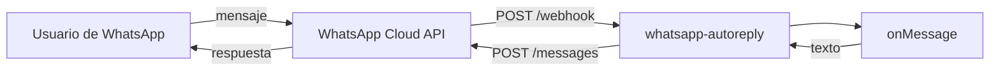

# Arquitectura

El módulo habla con una sola API: la WhatsApp Cloud API. Meta entrega los mensajes a un webhook nuestro y nosotros contestamos con un `POST` al número de la cuenta.



## Dos formas de correrlo

El mismo objeto hace las dos cosas.

| Modo | Quién escucha HTTP | Cuándo usarlo |
| --- | --- | --- |
| Servicio aparte | `bot.listen()` o `npm start` | El bot es un proceso propio, atrás de un túnel o de un balanceador |
| Embebido | La app anfitriona llama a `handleNodeRequest` | Ya hay una API y el webhook es una ruta más |

No hay framework, cola ni base. Eso es intencional: cualquier proyecto puede envolver estas funciones sin adoptar un runtime nuevo.

## Qué entra y qué sale

Meta manda un sobre con `entry[].changes[].value`. Ahí pueden venir `messages`, `statuses` o los dos. `extractMessages` se queda solo con `messages` y descarta el resto.

El handler no ve el sobre crudo. Ve un mensaje así:

```js
{
  id: 'wamid.HBg...',
  from: '5491112345678',
  timestamp: '1710000000',
  type: 'text',
  text: 'hola',
  name: 'Ada',
  phoneNumberId: '1065...',
  raw: { /* mensaje original de Meta */ }
}
```

`raw` conserva el payload original para cuando haya que leer imagen, audio, botón o un campo nuevo sin cambiar este contrato.

La respuesta del handler puede ser:

- nada, y no se envía mensaje
- un string
- `{ text: '...' }`
- un array de esos dos

El cliente arma el body que pide Cloud API: `messaging_product`, `recipient_type: individual`, `type: text` y el número con `+` cuando viene solo en dígitos. La versión del Graph API sale de `WHATSAPP_API_VERSION` y hoy cae en `v27.0`.

## Orden de un POST

1. Si hay app secret, se compara `X-Hub-Signature-256` contra el body crudo, con comparación en tiempo constante.
2. Se parsea el JSON y se extraen mensajes.
3. Si el `id` ya se contestó en este proceso, se saltea.
4. Se llama a `onMessage`. Si el envío a Meta falla, ese `id` no se marca y el webhook responde `500` para que Meta reintente.
5. Si no había nada que enviar, o el envío salió bien, se responde `200`.

El `GET` de alta es aparte: `hub.mode=subscribe`, el verify token y el `hub.challenge` que hay que devolver tal cual.

## Límites que conviene tener presentes

La respuesta de texto libre solo es válida dentro de la ventana de atención de 24 horas que abre el mensaje del usuario. Este bot solo contesta mensajes entrantes, así que cae dentro de esa ventana. Para escribirle a alguien que no escribió en las últimas 24 horas hacen falta plantillas aprobadas, y eso todavía no está modelado.

El dedupe vive en un `Set` del proceso, con un tope de 1000 ids. Un reinicio lo vacía. Si Meta reintenta después de un deploy, puede haber una segunda respuesta.

Sin `WHATSAPP_APP_SECRET`, cualquiera que conozca la URL puede disparar el handler. El proceso arranca igual y deja el aviso en el log.
