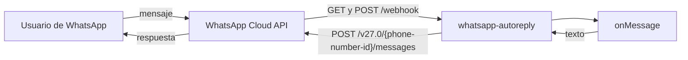

# Arquitectura

El módulo está escrito en TypeScript y Node lo ejecuta directo, sin compilar. Los tipos son solo anotaciones: no hay enums ni otra sintaxis que Node no pueda borrar al correr el archivo. Hace falta Node 22.18 o superior.

Habla con una sola operación de la WhatsApp Cloud API: enviar un mensaje de texto. Meta, por su lado, llama a nuestro webhook.



## Uso

Hay dos formas de usarlo y las dos pasan por `createWhatsAppBot`.

| Modo | Quién escucha HTTP | Cuándo usarlo |
| --- | --- | --- |
| Servicio aparte | `bot.listen()` o `npm start` | El bot es un proceso propio, atrás de un túnel o de un balanceador |
| Embebido | La app anfitriona llama a `handleNodeRequest` | Ya hay una API y el webhook es una ruta más |

Servicio aparte:

```bash
cp .env.example .env
npm start
```

Eso corre `src/server.ts`. Escucha `GET` y `POST` en `/webhook`, y `GET /health`.

Dentro de otro proyecto TypeScript:

```ts
import { createWhatsAppBot } from 'whatsapp-autoreply'
import type { IncomingWhatsAppMessage } from 'whatsapp-autoreply'

const bot = createWhatsAppBot({
  accessToken: process.env.WHATSAPP_ACCESS_TOKEN ?? '',
  phoneNumberId: process.env.WHATSAPP_PHONE_NUMBER_ID ?? '',
  verifyToken: process.env.WHATSAPP_VERIFY_TOKEN ?? '',
  appSecret: process.env.WHATSAPP_APP_SECRET,
  async onMessage(message: IncomingWhatsAppMessage) {
    if (message.type !== 'text' || !message.text) return
    return { text: `Recibimos: ${message.text}` }
  },
})
```

En un `http.Server` que ya exista, el resto de las rutas sigue siendo de la app:

```ts
import http from 'node:http'

const server = http.createServer((req, res) => {
  const path = new URL(req.url ?? '/', 'http://localhost').pathname
  if (path === '/webhook') {
    void bot.handleNodeRequest(req, res)
    return
  }
  res.writeHead(404)
  res.end()
})
```

`onMessage` puede devolver un string, `{ text }`, un array de esos dos, o nada. Si no devuelve nada, no se llama a Meta. `npm start` y el contenedor usan el menú de recetas, descrito en [recetas.md](recetas.md). El eco queda en `defaultReply` para quien no pasa un handler. `examples/custom-reply.ts` arma un saludo con el nombre del perfil.

`bot.client.sendText(to, body)` manda un texto por fuera del ciclo del webhook. `bot.client.send(payload)` manda cualquier body de mensaje, por si más adelante hace falta una plantilla, y sigue pegándole al mismo endpoint.

`npm run typecheck` corre `tsc --noEmit`. `typescript` y `@types/node` son dependencias de desarrollo: el proceso que atiende WhatsApp no instala paquetes.

## Endpoints de la Cloud API

La base es `https://graph.facebook.com`. La versión sale de `WHATSAPP_API_VERSION` y, si no está, es `v27.0`. El código que arma la URL está en `src/client.ts`.

### El único request que hacemos

`POST /{version}/{PHONE_NUMBER_ID}/messages`

Documentación de Meta: [Service messages](https://developers.facebook.com/documentation/business-messaging/whatsapp/messages/send-messages).

Solo se llama después de que `onMessage` devuelve texto. Un mensaje que no es texto, un duplicado, una firma inválida o un handler que no responde no llegan a este POST.

Headers:

| Header | Valor |
| --- | --- |
| `Authorization` | `Bearer ${WHATSAPP_ACCESS_TOKEN}` |
| `Content-Type` | `application/json` |

Body que arma `sendText`:

```json
{
  "messaging_product": "whatsapp",
  "recipient_type": "individual",
  "to": "+5491112345678",
  "type": "text",
  "text": { "preview_url": false, "body": "hola" }
}
```

`to` sale de `message.from`. Meta manda el número en dígitos, sin `+`. Si el valor es solo dígitos, le anteponemos `+` antes de enviarlo, porque sin el signo Meta le agrega el código de país del número de la cuenta. `preview_url` queda en `false` para no generar una vista previa de un link que venga en el texto.

El timeout es de 15 segundos (`AbortSignal.timeout`). Si la respuesta no es 2xx, se lee `error.message` del JSON de Graph y se lanza `WhatsAppApiError` con el status y el body. Ese error no marca el mensaje como contestado: el webhook responde `500` y Meta puede reintentar el POST. Si el envío sale bien, el id que devuelve Graph no se guarda; solo importa que la respuesta haya sido correcta.

`send(payload)` hace el mismo POST. Agrega `messaging_product` y `recipient_type` si el payload no los trae. Hoy el flujo automático no lo usa.

### Lo que Meta llama en este proceso

Esto no es un request nuestro a Graph. Es el webhook que se configura en la app. La ruta local es `WEBHOOK_PATH`, por defecto `/webhook`.

`GET /webhook` es el alta. Meta manda `hub.mode=subscribe`, `hub.verify_token` y `hub.challenge`. Si el modo es `subscribe` y el token coincide con `WHATSAPP_VERIFY_TOKEN`, devolvemos el challenge en texto plano y status 200. Cualquier otra combinación responde 403. No se llama a Graph.

`POST /webhook` es la notificación. El manejo, en este orden:

1. Si `WHATSAPP_APP_SECRET` está definido, se compara `X-Hub-Signature-256` con HMAC-SHA256 del body crudo. La comparación es en tiempo constante. Si no cierra, respondemos 401 y no se llama a Graph. Sin secret, el POST se acepta y el proceso avisa una vez en el log.
2. Se parsea el JSON. Un body vacío vale como `{}`. Un JSON inválido responde 400.
3. `extractMessages` recorre `entry[].changes[].value` y se queda con `value.messages`. Cada ítem pasa al handler así:

| Campo nuestro | De dónde sale en el webhook |
| --- | --- |
| `id` | `messages[].id` |
| `from` | `messages[].from` |
| `timestamp` | `messages[].timestamp` |
| `type` | `messages[].type`, o `unknown` si falta |
| `text` | `messages[].text.body`, solo cuando `type` es `text` |
| `name` | `contacts[].profile.name` del mismo `wa_id` |
| `phoneNumberId` | `metadata.phone_number_id` |
| `raw` | el objeto `messages[]` completo |

4. Si ese `id` ya se contestó en este proceso, se saltea.
5. Se llama a `onMessage`. Si devuelve texto, se hace el `POST /messages` de arriba.
6. Un lote sin mensajes, por ejemplo uno que solo trae `statuses`, responde 200 y no llama a Graph.

`statuses`, errores de entrega y el resto de campos que no están en `messages` se ignoran. Un mensaje que no es texto sí llega al handler, con `text` vacío y el original en `raw`. El handler por defecto no lo contesta.

## Límites que conviene tener presentes

La respuesta de texto libre solo es válida dentro de la ventana de atención de 24 horas que abre el mensaje del usuario. Este bot solo contesta mensajes entrantes, así que cae dentro de esa ventana. Para escribirle a alguien que no escribió en las últimas 24 horas hacen falta plantillas, y ese body todavía no está armado. El mismo `POST /messages` las acepta; no hay un segundo endpoint.

No se usan estos recursos de la Cloud API: marcar como leído, bajar media (`GET /{media-id}`), subir media, perfil del negocio, registro del número ni listado de plantillas.

El dedupe vive en un `Set` del proceso, con un tope de 1000 ids. Un reinicio lo vacía. Si Meta reintenta después de un deploy, puede haber una segunda respuesta.

Sin `WHATSAPP_APP_SECRET`, cualquiera que conozca la URL puede disparar el handler. El proceso arranca igual y deja el aviso en el log.
